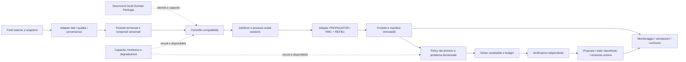

# Evoluzione per domini — Stage 1: audit e progetto di migrazione

24 ottobre 2026 · run `domain-evolution-20261024` · baseline privata `d0ec2c7`, checkpoint pubblico `4bdd161166724a641e45dca08cb9c514684609bc`, tag `stable-2026-10-24-pre-domain-evolution`. Reviewer: Codex self-check. Questo documento è il progetto richiesto dal prompt rivisto, non l'implementazione di un nuovo framework. La correzione UI contestualmente richiesta è separata. Autorità: SPEC/PLAN/CHECKLIST esistenti; nessuna modifica dei risultati storici o del manoscritto.

## Audit effettivo e responsabilità

Letti prompt originale, AGENTS/README/SPEC/PLAN/MEMORY/CHECKLIST e protocollo/evidenze pertinenti; verificato Git e ispezionati contratti, schemi, job, adapter, policy, servizi e moduli UI. Il codice applicativo era allineato al commit prima di iniziare; restano modifiche documentali/manoscritto estranee, non incluse nel checkpoint. Il checkpoint contiene il sorgente applicativo tracciato e le istruzioni di ricostruzione, non la VM o cache personali. Clone remoto indipendente:633hash conformi. Non è una nuova installazione da zero o certificazione operativa.

Stato reale: M0–M4 hanno PASS tecnici su fixture; slice successive e dashboard sono implementate. La qualificazione fisica, logistica/interventi, validazione storica e chiusura completa dei gate M5–M7 restano BLOCKED secondo la checklist. Il sistema non si trova semplicemente in M1. I PASS AT-EXT M3 riguardano la sostituzione controllata realmente provata, non qualsiasi modello futuro.

| Componente reale | Riscontro nel sorgente e stato | Classificazione / evoluzione proposta |
|---|---|---|
| Ingestione e cache | `ingest/`, servizi bounded in `web/`, forzanti e immagini distinte; fonti/coperture parziali già dichiarate | KEEP; EXTEND metadati tramite adapter solo quando necessari |
| Contratti | `contracts.py`, `schemas/`, `domain/contracts.py`; versioni già coesistenti e validazioni semanticamente rigorose | KEEP; nessuna sostituzione degli schemi correnti |
| Job e isolamento | `jobs.py`: coda, limiti, cancellazione, retry, receipt/stati/hash; processi ed ambienti separati nella stessa VM | KEEP; futuro punto di lookup, senza caricare motori nell'API |
| Dispatch | `adapters/pipeline.py` sceglie FIRE/FLOOD ed esige hash motori; worker `fire`, `fire_studio`, `flood`, `product` | REFACTOR dopo descriptor e test: wrapper compatibile, percorsi attuali invariati inizialmente |
| Studio incendi | `firelab.py`, `web/fire_workspace.py`, `dynamic_fire.py`, `fire_cases.py` e worker dedicati; validazione stretta, revisioni/ID e replay | KEEP; futuro adapter di scenario, non migrazione in-place del workspace |
| Alluvione | HMC→REFlEx attraverso worker ed input qualificati come ricerca; patch/limiti dichiarati | KEEP; non trasformare massimo su finestra in evoluzione idraulica o efficacia degli argini |
| Decisioni | `decision/problem.py`:0.5.0/0.6.0, FIRE/FLOOD, esposizione in persone o politica esplicita FIRE_IDEAL_ASSIGNMENT; solver, verifier, rolling e supervisor distinti | KEEP infrastruttura; REFACTOR policy solo in incremento dedicato con equivalenza |
| Adattamento | `adaptation/control.py` replay controllato distinto da salute reale e job; altri blocchi fail/timeout espliciti | KEEP; EXTEND profili capacità senza presentare replay come resilienza operativa dimostrata |
| API/UI | `web/server.py` compone servizi concreti; moduli frontend specifici, Monitoraggio/studi IT/EN | KEEP; REFACTOR composizione progressiva, senza rinominare tutte le route o riscrivere dashboard |
| Package generici | Non esiste un catalogo Domain Package universale qualificato | PROPOSED, non implementato in questo Stage 1 |
| Nuovi domini/ML/MDE | Estensioni possibili, non nuovi simulatori o generatori verificati | DEFER; nessun controllo nominale o dipendenza aggiunta |

Rischi concreti: enum FIRE/FLOOD, campi esatti nei validator, griglie/unità e finestre dei prodotti, semantica dell'esposizione, snapshot risorse, policy ideale e indipendenza del verifier; API/iframe e UI specifiche; riproducibilità dipendente da codice/ambienti/sorgenti congelati. Un registro non rimuove automaticamente questi accoppiamenti.

## Architettura logica proposta

È una responsabilità logica, non un piano di nuovi microservizi. I cinque livelli del prompt riusano componenti attuali; nessun secondo orchestratore accanto a JobStore o secondo decision engine. Il package descrive capacità, non autorizza installazione, esecuzione o impiego reale.

## Vocabolario: significati e confini

| Concetti | Distinzione da preservare |
|---|---|
| Domain / Phenomenon | Identità del contesto e processo descritto, non elenco globale chiuso di hazard |
| Observation / Event | Misura datata vs ipotesi/evento con evidenza e stato di conferma; un hotspot non è incendio confermato |
| SpatialEntity / InfrastructureAsset | Oggetto georiferito vs infrastruttura con attributi/versione/stato dichiarati; assenza in OSM non prova assenza fisica |
| Indicator / Hazard / RiskEstimate | Indice o pericolosità distinti dal rischio di conseguenza, che richiede esposizione/vulnerabilità e un modello adeguato |
| Exposure / Vulnerability / Impact | Entità interessate, suscettibilità al danno e conseguenza valutata; non inferire popolazione da un punto di località |
| Uncertainty | Rappresentazione tipizzata e ragione dell'ignoto; probabilità, ensemble, intervallo e missing non equivalenti |
| Model / Prediction / Scenario | Implementazione identificata, prodotto con validità, configurazione/ipotesi; previsione non necessariamente simulazione fisica |
| Resource / Intervention / Decision | Mezzo/capacità disponibili, azione ipotizzata con modello d'effetto, proposta verificata; nessuno equivale a dispatch autorizzato |

Non richiede venti classi vuote. Riusare record e schemi attuali. Ogni futuro prodotto dichiara CRS/datum/ordine assi/geometria o griglia, unità, risoluzione, semantica temporale (rilevazione/emissione/acquisizione/validità), identificativi delle fonti/hash/licenze, qualità/missing e incertezza. Campi non applicabili e campi sconosciuti hanno ragioni distinte, mai valori neutri inventati.

## Contratto Domain Package: proposta v0, non API implementata

Manifest dichiarativo JSON locale, validazione rigida e versionata; niente codice scaricato, import dinamici arbitrari o rete. I riferimenti indicano entry point/adapter già approvati dall'applicazione, non stringhe di shell eseguibili. Il primo incremento dovrà registrare SOLO wildfire e flood.

| Gruppo del descriptor proposto | Campi e vincoli |
|---|---|
| Identità | descriptor_schema, package_id, package_version, digest, core_compatibility; ID univoco/versione fissata, duplicati rifiutati |
| Semantica | vocabulary_refs, phenomena, entity_types; definizioni e versioni, senza sostituire gli enum legacy |
| Dati | requirements, provider_refs, coverage_policy; unità/CRS/time/missing/licenze e input obbligatori distinti dagli opzionali |
| Modelli | model_id/version/digest, kind, approved_adapter_ref, input/output_contract_refs, assumptions, validation_refs |
| Compatibilità | required_semantics, conversions, spatial_temporal_rules, uncertainty_rules; conversioni esplicite con evidenza, nessuna compatibilità dal solo tipo |
| Costo | requested_resources, execution_budget, cancellation/retry/idempotency, cache policy; rispettare i limiti globali VM/coda |
| Decisione | resource/intervention vocabularies, effect_models, policy_refs, constraint_rules, objective_units, verifier_refs; non una formulazione universale |
| Presentazione | layer descriptors, renderer_ref approvato, legenda, tempo, qualifica, label IT/EN; nessun layer attivo senza dati |
| Stato | installed, supported, data_available, scientifically_qualified e operationally_authorized separati; prova installazione non significa validazione |

Esempio di binding previsto: package `hazardia.wildfire` → attuali worker PROPAGATOR e politica ideale esplicitamente qualificata; `hazardia.flood` → attuale HMC→REFlEx e relativo prodotto di massimo allagamento. Traffico visuale e sismi osservati restano moduli separati con descrizione di capacità pertinente: non convertiti in simulatori fisici. I numeri di versione nuovi non vanno inventati per gli upstream; vanno ricavati dai manifest già fissati prima dell'implementazione.

Discovery proposto: leggere catalogo locale allowlistato → validare descriptor/versione/digest e collisioni → esporre metadati senza importare motori → accettare richiesta solo se capacità/dati/semantica/risorse richiesti sono supportati → eseguire lo stesso adapter e verifier. La mancanza di qualifica blocca la relativa pretesa operativa, non cancella risultati di ricerca già datati. I run storici conservano identità e contratti originali; descriptor nuovi non li reinterpretano.

## Contratti d'integrazione e composizione

- **Dati:** query con area/intervallo/cutoff e capacità richieste → prodotto riferito a snapshot/provenienza o errore classificato. Struttura nativa libera dentro l'adapter; nessuna normalizzazione che perda unità, incertezza o licenza.
- **Esecuzione:** richiesta accettata + input verificati + adapter identificato → receipt/job ID → stati/cancellazione/prodotto verificato. JobStore resta autorità; vincoli/preprocessing non diventano lavoro sincrono del thread HTTP.
- **Composizione:** binding tra variabile d'uscita e input, conversione, CRS/griglia, finestra/aggregazione, cutoff, condizioni iniziali, assunzioni ed incertezza. Se un obbligo manca: incompatibilità esplicita. La catena HMC→REFlEx resta l'integrazione concreta esistente, non una prova di composizione universale.
- **Decisione:** policy produce problema compatibile + obiettivi/unità e riferimenti ai vincoli; solver ritorna candidato/terminazione; verifier indipendente decide VALID/INVALID/UNKNOWN. Nessun fallback aggira UNKNOWN o qualifica aerea; nessuna azione reale.
- **Sistema esterno o MDE:** stessi contratti, versioni e prove di conformità. Un sottosistema può esporre più capacità; un artefatto generato richiede la stessa revisione/allowlist e non una fiducia speciale. Servizi remoti non introducono dipendenze commerciali obbligatorie.

Valutazione standard, non adozione: [OGC SensorThings](https://www.ogc.org/standards/sensorthings/) è candidato al confine sensori; [OGC API Processes](https://www.ogc.org/standards/ogcapi-processes/) al confine di esecuzione di processi esterni; [OpenMI](https://www.ogc.org/standards/openmi/) allo scambio runtime tra modelli. Consultate pagine ufficiali il24ottobre2026. **DEFER:** nessun sistema concreto oggi impone questi tre protocolli; nessuna conformità implementata o provata, nessuna installazione. L'adapter deve conservare i vincoli del modello anche quando il protocollo trasporta tipi compatibili.

## Migrazione per incrementi e criteri di accettazione

| Passo | Dipendenze e confine | Prova richiesta / rollback | Stato |
|---|---|---|---|
| A0 checkpoint | Sorgente tracciato corrente, export curato, tag privato/pubblico | Clone remoto e633hash; riferimento di ripristino senza toccare dati runtime | PASS |
| A1 audit/design | Stato effettivo M0–M7/AR-EXT e requisiti recenti | Questo audit e prompt rivisto; nessuna nuova astrazione runtime | PASS documentale |
| A2 descriptor/discovery | Revisione A1; due package esistenti, sola lettura | Positivi/negativi: collisione, versione/hash/adapter ignoto, nessun side effect/import pesante, avvio invariato | PROPOSED / NOT RUN |
| A3 dispatch compatibile | A2 e inventario capability/qualifica effettiva | Vecchio/nuovo percorso: stessi input/forzanti/semi/azioni; native equivalence se cambia esecuzione, retry/cancel/timeout e errori; rollback wrapper | DEFER |
| A4 policy | A3 e confronto solver/verifier, M3–M6 | Stesse assegnazioni/obiettivi/validazioni sul carico fissato; rifiuto policy ignota; non normalizzare persone e weighted_priority_points insieme | DEFER |
| A5 schemi e scenari | Necessità concreta dimostrata, A3–A4 | Vecchie versioni leggibili; migrazione opt-in di copie, archivi immutabili, indipendenza scenari, IT/EN e timeline | DEFER |
| A6 altri domini/MDE | Dati/licenze, modello, policy/verifier, validazione del dominio e autorizzazione specifica | Conformità e qualificazione separate, test di portabilità geografica | DEFER |

A2 è il prossimo incremento eseguibile proposto, non già avviato. A3–A6 non cambiano retroattivamente i PASS originali o i gate scientifici. Non si riapre M1 per rinominare il lavoro. Schema mismatch e vincoli critici causano rifiuto/classificazione, mai accettazione permissiva.

## Budget e regressioni

Nessuna soglia nuova arbitraria sostituisce QR/P0. Misurare prima/dopo sul medesimo hardware6vCPU/16GiB, ambienti e dataset fissati: avvio/cold-warm lookup, CPU/RAM/bytes del catalogo, coda e cancellazione, API/UI e decisione. A2 ha budget strutturale: zero import di motori e zero rete durante discovery; limiti dimensionali del descriptor saranno fissati sul pilot prima di dichiarare prestazioni. Il target60s resta risposta classificata sul carico dichiarato e p95 su almeno30esecuzioni, distinto dalla simulazione; non è garantito per nuovi domini arbitrari. Benchmarks della migrazione: NOT RUN.

Regression set obbligatorio: lettura workspaces/versioni legacy; hash archivi/run immutati; stessi payload accettati e rifiutati; native forcing/actions equivalenti quando pertinenti; UNKNOWN safety e autorizzazioni; scadenze/sorgenti mancanti; seed, policy e package identity; monitoraggio e livelli; IT/EN; authoring/pausa/seek/ricalcolo; confronto e ordine scenari. Il refactoring non qualifica efficacia dei mezzi, vulnerabilità o skill fisica.

## Decisioni, alternative e domande residue

Scelto progetto additivo con adapter: conserva evidenze e consente rollback. Scartata riscrittura universale di schemi/solver/UI; rinviati hot-plugin, microservizi, ontologia completa/servizio di registry e imposizione degli standard senza consumer. Nessuna necessità di maggiore RAM/CPU dimostrata da questo progetto.

Residui da risolvere in A2: granularità package dominio vs capacità trasversale, binding esatto dei manifest storici, versione minima del core, formato e limiti del descriptor, regole di compatibilità e ownership dei test. Non richiedono ora di cambiare la formulazione scientifica. Research recorder resta lo stesso agente; nessun agente autonomo/nuova ipotesi empirica. Nessun manoscritto modificato.

## Aggiornamento dopo autorizzazione A2 —24 ottobre 2026
La tabella precedente conserva il progetto Stage 1. Stato attuale A2: **PASS tecnico implementato**, con risultato negativo di replay esatto REFlEx esplicitamente conservato; [report](DOMAIN-PACKAGES-A2-20261024.md) e [contratto implementato](../docs/DOMAIN-PACKAGES.md). A3–A6 restano NOT RUN/DEFER. Non è ancora implementato un dispatch o un motore di composizione universale.

## Aggiornamento dopo autorizzazione A3 —24 ottobre 2026
A3 **PASS tecnico implementato**: lookup catalogo→tabella worker compatibile, ricevute, guard e supervisione preservati. [Report](DOMAIN-DISPATCH-A3-20261024.md):329testVM/11suiteJS e replay nativi, con FAIL esatto REFlEx conservato. A4–A6 restano NOT RUN/DEFER; nessuna migrazione schema o qualificazione nuova.

## Aggiornamento dopo autorizzazione A4 —24 ottobre 2026
A4 **PASS tecnico implementato**: policy 0.5/0.6 locali/immutabili, input e MILP equivalenti, verifier indipendente immutato. [Report](DECISION-POLICIES-A4-20261024.md):338testVM,122validator,6LP/soluzioni e8flussi equivalenti, pilot60decisioni. A5/A6 NOT RUN/DEFER per necessità concreta e qualificazione non dimostrate; nessuna rinomina/migrazione degli archivi.
