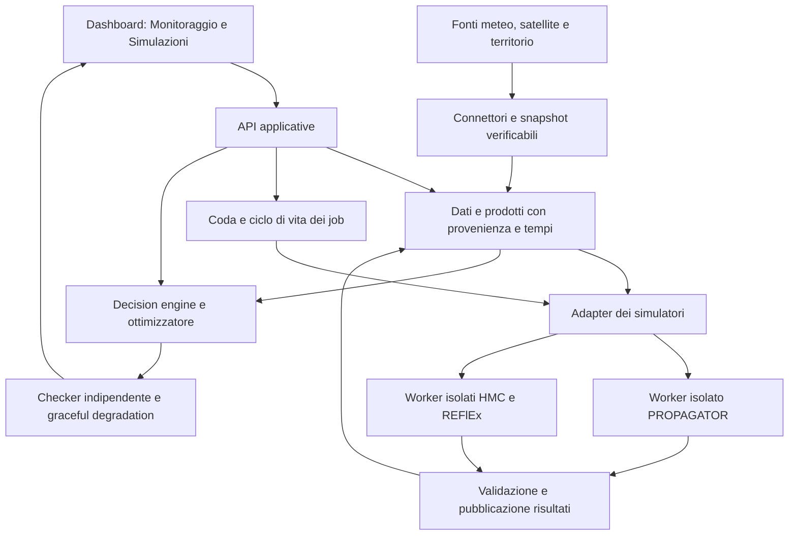

# MyDewetra come riferimento architetturale per HAZARDIA

Revisione `mydewetra-architecture-20261022`, 22 ottobre 2026. Revisore: Codex self-check. Rettifica confermata dall’utente: si prende spunto dall’architettura del paper; non si assume la parità funzionale con MyDewetra come nuovo obiettivo. Restano tutti i requisiti HAZARDIA già richiesti autonomamente. Nessuna modifica a runtime, simulatori, dashboard o manoscritto.

## Risposta alla domanda: collega applicazioni come PROPAGATOR?

Il paper *Engineering Early Warning Systems: an Industrial Experience* descrive **una piattaforma di integrazione di applicazioni, servizi e dati**. Le applicazioni hanno frontend e backend propri; condividono accesso, servizi cartografici e notifiche. È questo il riferimento architetturale utile a HAZARDIA.

Le pp.7–8, sezione5 e figure1–2 del PDF fornito, **non specificano un connettore PROPAGATOR**, un protocollo per avviarlo o un ciclo di vita dei suoi job. Nel testo estratto completo non compaiono i nomi PROPAGATOR, Continuum, HMC, REFlEx o FloodProof. Questo delimita quanto possiamo attribuire al paper: non dimostra che il prodotto completo non li integri.

Il paper dice che si possono integrare applicazioni modulari per diversi utenti e domini, ma un’applicazione non coincide necessariamente con un simulatore. “Integrare” può significare mostrare prodotti già calcolati, richiamare un servizio remoto oppure eseguire un algoritmo. Per HAZARDIA definiamo esplicitamente quale responsabilità ha ogni componente.

## Architettura documentata nel paper

| Componente | Responsabilità documentata | Fonte |
|---|---|---|
| Portal frontend e App1…AppN | Punto di accesso e applicazioni modulari, ciascuna con frontend Angular e backend dedicato | p.7 fig.1 |
| Identity provider e Portal service | Autenticazione e informazioni di autorizzazione applicative, recuperabili via API | p.7 |
| API Gateway | Collegamento dei frontend ai backend applicativi | p.7 fig.1 |
| DDS, MyDewetra Data System | Plugin GeoServer: pubblicazione di layer variabili nel tempo, dati nativi e livelli WMS per la mappa | p.7 |
| Data acquisition job e database | Acquisizione schedulata delle fonti e persistenza per tipologia di dato | p.8 |
| Message broker | RabbitMQ per notificare nuovi dati e aggiornamenti ai servizi iscritti | pp.7–8 |
| Sentinel service | Elaborazioni sui superamenti di soglia delle osservazioni, Java/Spring | pp.7–8 |
| Print e Chart services | Generazione di report PDF e grafici richiamata dagli altri servizi | p.7 |
| Monitoring dashboard | Metriche operative dei servizi in formato Prometheus | p.8 |

L’esempio concreto di fig.2 è: misura del pluviometro → PostgreSQL → messaggio → Sentinel legge e somma le ultime6h → eventuale messaggio di superamento → DDS aggiorna i client tramite WebSocket. Non è una dimostrazione del collegamento con un simulatore. “Sentinel” qui è il servizio di soglie, non il satellite Copernicus Sentinel.

## Cosa aggiunge l’ispezione dei sorgenti storici

Fonti già acquisite e congelate nella precedente revisione: repository CIMA `mydewetra-src`, commit `4c20f78dc20a702defca33e71f23c324be9f417f`, archivio `dewetra2-backend.zip`. Ispezione statica, senza importare o eseguire codice esterno. Hash e membri controllati in `reports/mydewetra-architecture/review.json`.

1. `dewetra2/algorithms/resources.py`: risorsa HTTP POST `/run`, riceve `alg` e `input`, importa il modulo algoritmico e richiama la funzione, restituendone il risultato. È un esempio concreto di punto d’integrazione per algoritmi. Il frammento esaminato esegue la funzione nel percorso della richiesta; non documenta da solo una coda asincrona, cancellazione, timeout o wrapper PROPAGATOR. Il contesto completo di autorizzazione non è stato ricostruito.
2. `dewetra2/layers/floodproof/resources.py`: legge proprietà, serie e feature tramite il DDS, con endpoint per layer e serie compatibili. Dimostra il collegamento a **prodotti/serie del modello**; il frammento non mostra l’avvio del motore FloodProof.
3. `DOCUMENTAZIONE_dds.md` e `dds_client2.py`: proprietà dei layer, serie temporali, disponibilità, stili e interrogazioni. Separano il prodotto pubblicato dal motore che lo ha generato.

Questi file storici non vengono attribuiti automaticamente alla nuova architettura del paper. Nessun loro codice è stato copiato in HAZARDIA. Riprendiamo il principio di separazione delle responsabilità; non replichiamo il dispatch dinamico di nomi di moduli forniti dalla richiesta. Gli adapter HAZARDIA mantengono i motori ammessi e i controlli già previsti.

## Traduzione nell’architettura HAZARDIA

| Principio ripreso | Collocazione concreta in HAZARDIA | Stato verificato in questa revisione |
|---|---|---|
| Applicazioni modulari con accesso coerente | Monitoraggio e Simulazioni nella stessa UI; moduli di dominio separati dal decision engine | PASS statico sul codice esistente; non equivalenza industriale |
| Integrazione delle fonti prima della visualizzazione | `ingest/`, snapshot, cache, licenze, disponibilità temporale e qualità | PASS statico; i controlli delle singole fonti restano quelli dei rispettivi report |
| Pubblicazione dei prodotti separata dal calcolo | `HazardProduct`, meteo versionato, manifest e API della dashboard | PASS statico; metadati e cataloghi oggi distribuiti, non un DDS/WMS universale |
| Punto esplicito d’integrazione degli algoritmi | Contratti di richiesta → `JobStore` → adapter/workers → prodotto verificato | PASS statico; esistono già esecuzioni native nei report precedenti, non ripetute qui |
| Aggiornamenti disaccoppiati fra dati, elaborazioni e UI | Stato dei job, API e polling esistenti; non richiedono il broker RabbitMQ per questa VM | PASS come mappatura di responsabilità; non è un event bus uniforme già implementato |
| Metriche della piattaforma distinte dai rischi territoriali | Tempi, coda, fallimenti, età e qualità delle fonti | PASS statico per controlli esistenti; nessuna nuova misura o parità Prometheus |

Schema logico di destinazione, che mette in relazione responsabilità già previste. Non è una dichiarazione che ogni collegamento sia già completo:

Per un incendio: la UI chiede una simulazione tramite l’API; una richiesta versionata riferisce inneschi, risorse, terreno e meteo congelati; il job invoca l’adapter; il worker esegue PROPAGATOR; controlli e manifest precedono la pubblicazione delle mappe. L’ottimizzatore usa dati/prodotti dichiarati e il checker verifica la proposta: la decisione non si deduce da una semplice notifica di soglia.

Il concetto di connettore è quindi duplice e concreto: **adapter che prepara input e avvia un motore**, e **pubblicazione che rende consultabili i suoi output**. Un layer WMS o una mappa di un risultato non provano che la piattaforma abbia avviato quel simulatore.

## Decisione per il piano

- Conservare M0–M7, AR-EXT-01, primi moduli incendi/alluvioni, UI generica con due percorsi principali, fonti gratuite, unica VM e portabilità geografica.
- Usare MyDewetra per verificare confini fra applicazioni, integrazione delle fonti, pubblicazione temporale dei dati e aggiornamento dei client. Non imporre ora GeoServer, RabbitMQ, Keycloak, Angular o un servizio per ogni riquadro del diagramma. Confini logici e deployment sono scelte distinte.
- Mantenere le capacità HAZARDIA già richieste: simulazioni fisiche, authoring/scenari, meteo, risorse/priorità, ottimizzazione robusta, rolling horizon, deadline e graceful degradation. Il chiarimento non rimuove il Monitoraggio né annulla l’integrazione di pioggia osservata richiesta separatamente.
- Ritirare l’obiettivo aggiunto di parità funzionale con MyDewetra. L’inventario MB-01…08 resta storico con gli esiti originari; le verifiche HAZARDIA equivalenti sopravvivono soltanto se richieste dal piano originale o da istruzioni autonome. Bollettini o funzioni non richieste non diventano lavori obbligatori per il solo fatto di essere nel paper.
- **Prossimo incremento architetturale proposto, non implementato:** inventario comune dei prodotti/layer già esistenti con identificativo/versione, fonte/licenza, unità, geometria/CRS, tempi di disponibilità/validità, job generatore, qualità e qualificazione. Collegarlo agli adapter esistenti senza modificare il decision core; verificare che pubblicazione e aggiornamenti rispettino quei metadati. Valutare un’infrastruttura diversa soltanto se una necessità misurata la giustifica.

## Esiti

| ID | Attività | Esito |
|---|---|---|
| MD-ARCH-01 | PDF identificato via SHA256; pp.7–8 e figure1–2 verificate integralmente | PASS documentale |
| MD-ARCH-02 | Distinzione fra avvio algoritmo e lettura prodotti nei due membri dell’archivio storico | PASS statico |
| MD-ARCH-03 | Connettore PROPAGATOR specificato ed eseguito dagli autori | NOT RUN: non specificato nelle evidenze lette; nessun giudizio sul prodotto completo |
| MD-ARCH-04 | Mappatura ai contratti/job/adapter/prodotti HAZARDIA esistenti | PASS statico, non nuova prova runtime |
| MD-ARCH-05 | Rettifica della parità funzionale in SPEC e registri ufficiali | PASS documentale dopo controllo delle modifiche |
| MD-ARCH-06 | Nuova installazione, replica MyDewetra, benchmark, nuova simulazione o modifica del manoscritto | NOT RUN, fuori da questo incremento |

Nessun nuovo risultato sperimentale, claim di novità o superiorità prestazionale. Full M5–M7 e qualificazione scientifica restano BLOCKED come prima. Non serve replicare l’intero prodotto per usare correttamente questo riferimento architetturale.
